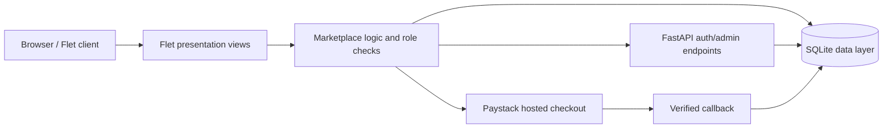
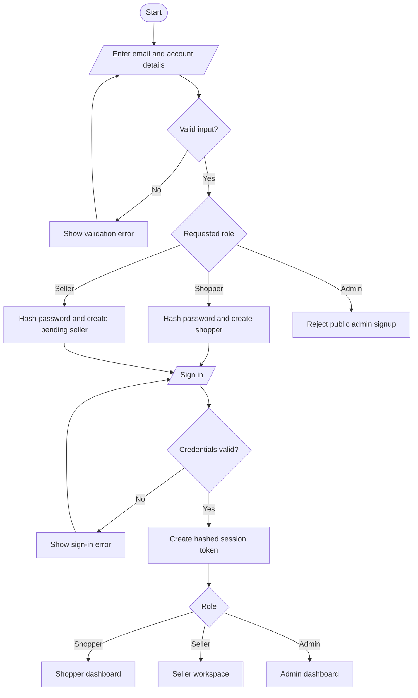
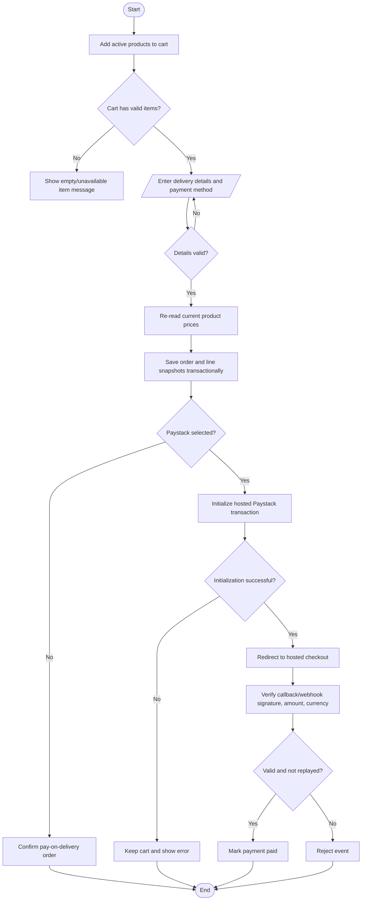
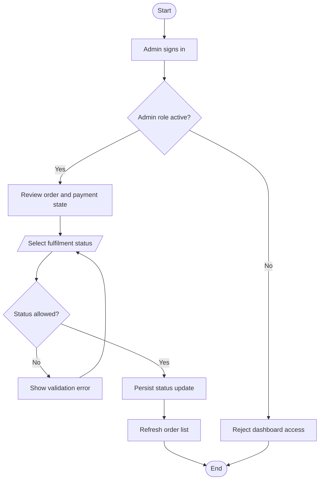

# KwajiBuy Marketplace E-commerce Application

**Course:** CSC/CSE 720 E-Commerce Technology  
**Implementation:** Python, Flet, FastAPI, SQLite  
**Report date:** 1 October 2026  
**Project status:** Working MVP; public production deployment and external user acceptance testing are not complete.

## 1. Executive Summary

KwajiBuy is a Nigerian marketplace MVP connecting shoppers with local sellers. The selected focus is curated everyday goods from independent Nigerian sellers, especially fashion accessories and home/lifestyle products. The sample catalogue also contains a small set of electronics to exercise marketplace search and checkout.

The application provides shopper and seller registration, password sign-in, role-specific workspaces, seller approval, a SQLite product catalogue, cart and checkout, persisted orders, admin fulfilment controls, and an optional Paystack hosted-payment integration. The interface is implemented in Flet and served to web browsers through FastAPI. SQLite is the MVP data store.

The current implementation is suitable for coursework demonstration, not production commerce. It has no stock reservation, delivery integration, product image upload, refund workflow, or persistent cart. Demo logins are explicitly opt-in. No live Paystack transaction, external UAT, stakeholder interview, or production security audit is claimed in this report.

## 2. Problem, Aim, and Objectives

### Problem statement

Small Nigerian sellers may rely on informal social channels to publish goods and confirm orders. Shoppers can have difficulty comparing listings, identifying the seller, tracking order status, and understanding payment and return expectations. KwajiBuy demonstrates a single marketplace workflow for those tasks.

### Aim

Build and evaluate a cross-platform Flet marketplace prototype for local Nigerian sellers and shoppers.

### Objectives

1. Provide role-aware shopper, seller, and administrator accounts.
2. Allow approved sellers to create, edit, pause, and republish product listings.
3. Allow shoppers to search and browse active listings, manage a cart, and place orders.
4. Persist profiles, products, orders, order lines, and payment events in SQLite.
5. Provide order fulfilment and seller-application management to administrators.
6. Demonstrate a server-side Paystack integration without storing card data.
7. Test core authentication, catalogue ownership, order, and webhook behavior.

## 3. Project Approach

The work follows an iterative SDLC sequence:

| Phase | KwajiBuy activity | Evidence/output |
|---|---|---|
| Analysis | Select local-seller marketplace niche; review assignment guide and Jumia shopping patterns; identify roles and risks | This report, requirements, and fact-finding status |
| Design | Define role workflows, SQLite entities, Flet views, and payment boundary | Architecture, ERD, algorithms, flowcharts, pseudocode |
| Development | Implement Flet UI, FastAPI endpoints, SQLite persistence, and Paystack integration hooks | `main.py`, `requirements.txt`, Dockerfile |
| Testing | Run standard-library unittest cases against temporary databases | Five automated tests pass |
| Deployment | Provide a Dockerfile and local run instructions | Container recipe supplied; image build/live deployment not verified |

## 4. Feasibility Study

### Technical feasibility

The prototype uses Python 3.9+, Flet 0.28.3, FastAPI, Uvicorn, HTTPX, and SQLite. These tools support the current single-codebase web demo. SQLite is sufficient for a single-instance coursework MVP; a production marketplace would need a managed relational database, migration management, backups, and concurrency/load testing. One developer with basic Python/Flet and database skills can maintain the prototype. Mobile and desktop targets are possible with Flet, but this submission has only been exercised as a web app.

### Economic feasibility

The coursework MVP uses open-source Python packages and SQLite. Local development has no hosting or payment-processing cost. A live service would incur domain, hosting, database/backups, monitoring, email delivery, and support costs; payment fees and vendor prices must be confirmed from current provider quotations. No revenue forecast is asserted because no market survey or seller interviews have been completed.

### Operational feasibility

The system separates shopper, seller, and administrator tasks and presents pay-on-delivery as an accessible MVP option. Sellers require admin approval before listing products. Operational acceptance remains unverified: the team must observe representative shoppers and sellers using the app, then record usability issues and task completion rates.

### Legal feasibility

The app stores account, contact, delivery, order, and seller data. A real launch must assess Nigeria's NDPA 2023 and applicable regulations, and GDPR where relevant. It needs a reviewed privacy notice, retention/deletion process, data-subject request handling, processor agreements, access controls, and incident response. Paystack hosted checkout avoids handling raw card details in KwajiBuy, but does not by itself certify payment, privacy, or PCI compliance. The policy text in the MVP is illustrative, not legal advice or certification.

### Schedule feasibility

An indicative six-week delivery plan is feasible for a student MVP:

| Week | Work |
|---|---|
| 1 | Stakeholder interviews/questionnaire, requirements, feasibility, scope approval |
| 2 | Wireframes, data model, algorithms, flowcharts, security review |
| 3 | Authentication, role routing, seller catalogue, search |
| 4 | Cart, checkout, orders, admin workflows, payment sandbox integration |
| 5 | Functional/security/accessibility tests, fixes, alpha and beta feedback |
| 6 | User acceptance test, deployment rehearsal, screenshots, final report |

The actual external UAT and deployment activities remain outstanding.

## 5. Fact-Finding

### Evidence collected so far

- **Document analysis:** the supplied coursework guide was used to extract the Python/Flet constraint, SDLC deliverables, three-tier design, accessibility, security, policy, testing, and deployment expectations.
- **Online research/observation:** Jumia Nigeria was reviewed as a marketplace interaction reference. The KwajiBuy interface uses familiar search, category, cart, seller, and trust signals while retaining its own name and visual design.
- **Code/database inspection:** implemented roles, routes, SQLite entities, and test outcomes were checked against the system requirements.

### Research not yet conducted

No actual buyer/seller interviews, questionnaire responses, in-person observation, or UAT results are available. They must not be represented as completed. Before production or final coursework submission, collect and attach dated, consented evidence.

Suggested fact-finding plan:

| Technique | Participants/material | Questions or observation focus | Evidence to retain |
|---|---|---|---|
| Interview | 3-5 prospective shoppers and 2-3 sellers | How are listings, delivery, payment, returns, and trust handled today? | Consent note, anonymized notes, date |
| Questionnaire | At least 10 potential shoppers | Preferred payment, categories, delivery expectations, trust concerns | Blank questionnaire, anonymized response summary |
| Observation | 3 shoppers using the prototype | Find a product, add to cart, checkout, find order status | Task time, completion, errors, consented notes |
| Document analysis | Coursework guide, current applicable laws, payment-provider docs | Required deliverables, obligations, integration requirements | Source register with access date |

## 6. Software Requirements Specification

### User classes

- **Guest:** browse/search catalogue, view cart, and use guest checkout.
- **Shopper:** manage profile, sign in/out, browse, checkout, and view their own order history.
- **Seller:** register, await approval, manage their own catalogue after approval, and view application/listing status.
- **Administrator:** review order/payment summaries, update fulfilment states, and approve/reject seller applications.

### Functional requirements

| ID | Requirement | Current status |
|---|---|---|
| FR-01 | Register shopper or seller with unique email and password of at least 12 characters | Implemented |
| FR-02 | Sign in/out; store salted PBKDF2-HMAC-SHA256 password hashes and revocable, hashed session tokens | Implemented; security hardening still required |
| FR-03 | Prevent public self-registration as administrator | Implemented; admin bootstrapped from environment |
| FR-04 | Search/filter active products by name, category, and seller | Implemented |
| FR-05 | Allow approved sellers to create, edit, pause, and republish only their own listings | Implemented in current code; included in regression tests |
| FR-06 | Add/remove cart items and change quantities | Implemented; cart is session-only |
| FR-07 | Validate checkout details and persist order and line-item price snapshots | Implemented |
| FR-08 | View shopper profile and orders scoped to the authenticated account | Implemented |
| FR-09 | Allow admin to review orders, update fulfilment status, and review seller applications | Implemented |
| FR-10 | Initiate hosted Paystack payment; verify callback/webhook signature, currency, amount, and replay | Implemented as an optional integration; live transaction not tested |
| FR-11 | Manage stock quantity, reserve inventory, and prevent overselling | Not implemented |
| FR-12 | Send delivery updates, process returns/refunds, and issue seller payouts | Not implemented |

### Non-functional requirements

| ID | Requirement/target | Current evidence or gap |
|---|---|---|
| NFR-01 Security | Hash passwords; restrict roles; parameterize SQL; keep payment secret server-side | Implemented in core; no independent penetration test |
| NFR-02 Privacy | Shopper sees only own profile/order history | UI scopes queries by authenticated email; verify in future access-control tests |
| NFR-03 Performance | Typical catalogue/search response under 2 seconds for MVP dataset | Not benchmarked; measure before sign-off |
| NFR-04 Reliability | Order and order lines commit atomically; webhook replay is idempotent | SQLite transaction and automated webhook test |
| NFR-05 Usability | Responsive, clear role entry, labeled inputs, clear status and empty states | Flet web UI; formal usability study pending |
| NFR-06 Maintainability | Single codebase, documented setup, standard-library tests | Present, though current implementation is concentrated in `main.py` |
| NFR-07 Availability | Local/Docker runnable; production uptime target defined with host | Local runnable; production SLO not defined |
| NFR-08 Accessibility | Keyboard-operable controls, labels, contrast, responsive layouts | Basic labels/tooltips; WCAG 2.2 audit not completed |

### Hardware and software requirements

**Development:** macOS, Windows, or Linux computer; Python 3.9+; internet connection to install packages and load remote demo images; VS Code or another Python IDE.  
**Runtime:** Python 3.9+ with dependencies in `requirements.txt`, writable storage for SQLite, and network/TLS egress when Paystack is configured. Docker is optional.  
**Production:** HTTPS reverse proxy, securely injected secrets, persistent database storage, backups, monitoring, and a supported deployment host are required before launch.

## 7. System Design

### Architecture



The application is a logical three-tier system: presentation, business logic, and data. FastAPI routes share the same ASGI application as the Flet web UI. The catalogue is stored in SQLite and seeded from the initial sample list on first startup.

### Database design / ERD

```mermaid
erDiagram
    USERS ||--o{ USER_SESSIONS : has
    USERS ||--o| SELLER_PROFILES : owns
    USERS ||--o{ PRODUCTS : lists
    ORDERS ||--|{ ORDER_ITEMS : contains
    USERS ||--o{ PRODUCTS : seller
    PRODUCTS }o--o{ ORDER_ITEMS : snapshots
    ORDERS ||--o{ PAYMENT_EVENTS : receives
    USERS {
        int id PK
        string email UK
        string full_name
        string password_salt
        string password_hash
        string role
        bool active
    }
    USER_SESSIONS {
        string token_hash PK
        int user_id FK
        datetime expires_at
    }
    SELLER_PROFILES {
        int user_id PK_FK
        string store_name UK
        string status
    }
    PRODUCTS {
        string product_id PK
        int seller_id FK
        string seller_name
        string name
        string category
        int price_ngn
        int compare_at_ngn
        string image_url
        bool active
    }
    ORDERS {
        string order_id PK
        string customer_email
        int total_ngn
        string payment_method
        string payment_status
        string order_status
    }
    ORDER_ITEMS {
        int id PK
        string order_id FK
        string product_id
        string product_name
        int quantity
        int unit_price_ngn
    }
    PAYMENT_EVENTS {
        string event_key PK
        string paystack_reference
    }
```

Order items snapshot product name and unit price so later catalogue edits do not rewrite historical orders. Current products are soft-deactivated; existing order snapshots remain intact. `customer_profiles` stores shopper contact/address data keyed by the authenticated account email.

### Interface and I/O design

| View | Main inputs | Main outputs/actions |
|---|---|---|
| Storefront | Search text, category | Product cards, verified seller, price/rating, add to bag |
| Cart | Quantity increment/decrement, remove | Item count, subtotal, checkout |
| Account | Sign-in credentials, profile fields | Role-specific destination, profile, recent orders |
| Seller workspace | Listing name/category/prices/image URL/tag | Active/paused listing table and marketplace visibility |
| Checkout | Name, phone, address, email, payment method | Order confirmation or Paystack hosted checkout |
| Admin dashboard | Fulfilment status, seller approval status | Order/payment metrics, seller review queue |

## 8. Algorithms

### Registration and authentication

1. Normalize email and validate required fields and password length.
2. Reject requested roles except shopper or seller; admin is bootstrap-only.
3. For seller signup, create a pending seller profile.
4. Generate a cryptographic salt and derive PBKDF2-HMAC-SHA256 password hash.
5. On login, retrieve the stored salt/hash, derive candidate hash, and compare using constant-time comparison.
6. On success, generate random session token, store only its SHA-256 hash and expiry, and route by role.
7. On logout, revoke the hashed token and clear the Flet server-side page session.

### Seller product management

1. Read authenticated user and require role=seller and status=approved.
2. Validate name, supported category, positive integer price, compare-at price, and optional image URL.
3. Create a unique product ID and persist seller ownership and listing fields.
4. For edits/pauses, update only where both product ID and seller ID match.
5. Search returns active listings only; order placement re-reads active price from the database.

### Cart and checkout

1. Add a product ID to the page-session cart or increment its quantity.
2. Before display/checkout, resolve cart IDs against active database products.
3. Calculate subtotal from current active product prices.
4. Validate buyer name, phone, and address; require email for Paystack.
5. In one SQLite transaction, save order and immutable order-item snapshots.
6. For pay-on-delivery, show order confirmation. For Paystack, initialize hosted transaction, store reference, then redirect.

### Order fulfilment and payment callback

1. Require admin authorization before order or seller updates.
2. Validate the requested status against the allowed state set.
3. Save the order status using a parameterized update.
4. For Paystack callback, verify server-side with provider; for webhook, validate HMAC-SHA512 signature.
5. Check success status, NGN currency, and exact amount; insert unique payment event and mark paid in a transaction.

## 9. Flowcharts

### Registration and login



### Checkout and payment



### Order fulfilment



## 10. Pseudocode

### Login

```text
FUNCTION login(email, password)
    normalizedEmail = LOWERCASE(TRIM(email))
    user = FIND_ACTIVE_USER(normalizedEmail)
    IF user is missing THEN RETURN authentication_error
    candidateHash = PBKDF2_SHA256(password, user.salt, configuredIterations)
    IF CONSTANT_TIME_COMPARE(candidateHash, user.passwordHash) is false
        RETURN authentication_error
    token = CRYPTOGRAPHIC_RANDOM_TOKEN()
    STORE(SHA256(token), user.id, expiry)
    RETURN token and role-specific destination
END FUNCTION
```

### Add and update a product

```text
FUNCTION saveProduct(user, form, productId)
    REQUIRE user.role = seller AND user.sellerStatus = approved
    VALIDATE name, realCategory, positivePrice, compareAt >= price
    IF productId is empty THEN
        INSERT product with owner = user.id
    ELSE
        UPDATE product WHERE id = productId AND owner = user.id
        IF affectedRows = 0 THEN RETURN ownership_error
    END IF
    RETURN saved product
END FUNCTION
```

### Checkout

```text
FUNCTION checkout(cart, buyer, paymentMethod)
    REQUIRE cart is not empty
    FOR each item in cart
        product = FIND_ACTIVE_PRODUCT(item.id)
        IF product is missing THEN RETURN unavailable_item
        subtotal += product.currentPrice * item.quantity
    END FOR
    VALIDATE buyer.name, buyer.phone, buyer.address
    BEGIN TRANSACTION
        order = INSERT order(subtotal, buyer, paymentMethod)
        INSERT each order line with product name/price snapshot
    COMMIT
    IF paymentMethod = paystack THEN RETURN HOSTED_GATEWAY_URL(order)
    RETURN order confirmation
END FUNCTION
```

### Payment webhook

```text
FUNCTION handleWebhook(rawBody, signature)
    expected = HMAC_SHA512(configuredSecret, rawBody)
    IF constantTimeCompare(signature, expected) is false THEN REJECT
    event = PARSE_JSON(rawBody)
    REQUIRE event.type = charge.success
    BEGIN TRANSACTION
        order = FIND_ORDER(event.reference)
        REQUIRE event.currency = NGN AND event.amount = order.total * 100
        INSERT paymentEvent(event.type + reference) IF NOT EXISTS
        IF inserted THEN SET order.paymentStatus = paid
    COMMIT
    RETURN processed or already_processed
END FUNCTION
```

## 11. Security, Privacy, and Accessibility

- Passwords are salted and processed with PBKDF2-HMAC-SHA256; session tokens are random, stored hashed, expire after 30 days, and can be revoked.
- Public signup allows shopper/seller only. Admin is seeded from environment; sellers must be approved before catalog mutation.
- SQL statements use parameters. Seller mutations include both product ID and owner ID.
- Paystack secret remains server-side; webhook signature uses HMAC-SHA512; amount/currency are checked; event key prevents duplicate processing.
- The current admin compatibility service token is suitable only for local/coursework integration; production should rely on hardened admin identity and secure deployment secrets.
- WCAG 2.2 review should cover keyboard operation, semantics, focus visibility, color contrast, zoom/reflow, error announcements, and screen-reader navigation. Current Flet labels/tooltips are not a complete accessibility audit.
- OWASP Top Ten review is a required future gate; particularly test access control, injection, authentication/session management, security misconfiguration, and logging/monitoring.
- No raw card data is collected. Payment status still requires provider reconciliation and operational refund handling.

## 12. Test Evidence

Run:

```bash
.venv/bin/python -m unittest discover -s tests -v
```

**Latest result:** 5 tests passed (1 October 2026).

| Test | Input/setup | Expected result | Actual |
|---|---|---|---|
| Shopper login, checkout, history, logout | Register buyer, login, create two-item order, logout | Correct role/session, ₦859,800 order total, order scoped to email, token rejected after logout | Pass |
| Admin self-registration protection | Public signup requests `role=admin` | Request rejected; unauthenticated admin orders denied | Pass |
| Seller listing ownership | Pending seller attempts create, admin approves, another seller attempts edit | Pending create denied; owner can edit; other seller cannot | Pass |
| Seller product checkout | Approved seller creates a Home product and buyer orders it | Order saves the database product ID and unit-price snapshot | Pass |
| Paystack webhook | Invalid signature then valid success event twice | Invalid rejected; valid processed once; duplicate marked already processed | Pass |

The test suite uses temporary SQLite databases. It does not constitute browser/mobile end-to-end testing, load testing, security penetration testing, or UAT. Paystack network calls are not exercised against live credentials.

## 13. Screenshots and Demonstration Evidence

The storefront screenshot was captured from the running web app on 2 October 2026 and is included at [`screenshots/storefront.png`](screenshots/storefront.png). It shows the first storefront viewport. The following additional screenshots should be captured from a running local app before final submission:

1. Storefront search/category grid and mobile reflow.
2. Registration and sign-in, including shopper/seller/admin demo roles.
3. Shopper dashboard with profile, recent orders, and cart access.
4. Cart quantity update and checkout validation.
5. Seller product creation, listing table, pause/republish action, and pending approval state.
6. Admin order/payment KPIs, order status control, and seller approval queue.
7. Paystack test-mode result and webhook response using test credentials only.

Record screenshot date, viewport, and test account role. Do not include real passwords, payment details, private addresses, or customer data.

## 14. Deployment and User Documentation

### Local installation

```bash
python3 -m venv .venv
source .venv/bin/activate
python -m pip install -r requirements.txt
KWAJIBUY_ENABLE_DEMO_ACCOUNTS=1 python main.py
```

Open `http://localhost:8550`. The demo flag enables one-click local role shortcuts and must remain off outside a controlled demo. For a real admin account, set `KWAJIBUY_ADMIN_EMAIL` and a unique `KWAJIBUY_ADMIN_PASSWORD` (minimum 12 characters) before startup. Set `KWAJIBUY_PAYSTACK_SECRET_KEY` and a public HTTPS callback URL only when using provider test credentials.

### Buyer guide

1. Browse or search by product, category, or seller.
2. Add products to the bag and open `/cart` to adjust quantities.
3. Continue to checkout, enter delivery details, and choose pay-on-delivery or configured Paystack.
4. Sign in at `/account` to save profile data and view orders for that account.

### Seller guide

1. Create an account and select seller.
2. Wait for administrator approval; pending accounts cannot publish products.
3. In `/seller`, create a product with a real category, price, compare-at price, and optional image URL.
4. Edit a listing or pause/republish it. Only the owning seller can change it.

### Administrator guide

1. Sign in using the environment-bootstrapped administrator or an explicitly enabled demo role.
2. Review order, paid-online, order-value, and seller-application metrics at `/admin`.
3. Approve/reject seller applications and update order fulfilment status.

### Known limitations / FAQ

- **Can a seller manage stock or payouts?** Not yet. The MVP supports listing management, not stock reservation or payouts.
- **Does the cart survive a browser restart?** No. It is stored for the active Flet page session.
- **Are demo accounts real customers?** No. They are local demonstration identities enabled by an environment flag.
- **Does the report claim interviews or UAT?** No. Those activities remain to be conducted and documented.
- **Is the app publicly deployed?** No. A Dockerfile is included; image build and live deployment have not been verified here.

## 15. References

- CSC/CSE 720 Coursework Guide supplied with the project, “E-Commerce Technology: Build and deploy an e-commerce app.”
- Jumia Nigeria storefront, reviewed as a high-level marketplace interaction reference: `https://www.jumia.com.ng/` (accessed 1 October 2026).
- Nigeria Data Protection Act 2023; GDPR where applicable.
- W3C Web Content Accessibility Guidelines (WCAG) 2.2.
- OWASP Top Ten project, current release to be confirmed during the production security review.
- Paystack transaction initialization, verification, and webhook documentation; confirm the current provider documentation before deployment.